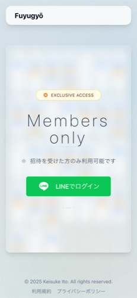
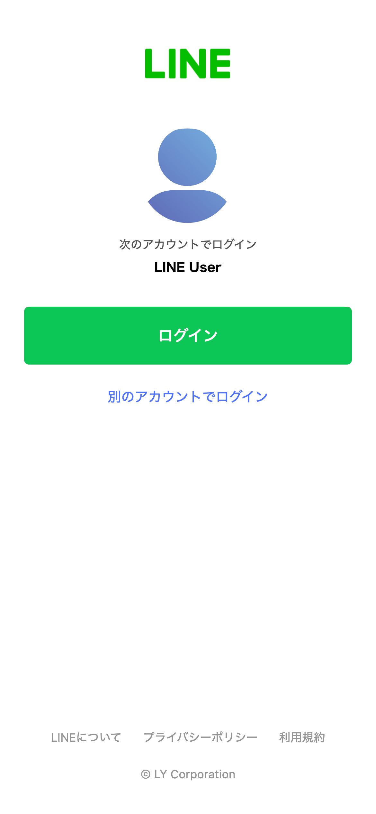
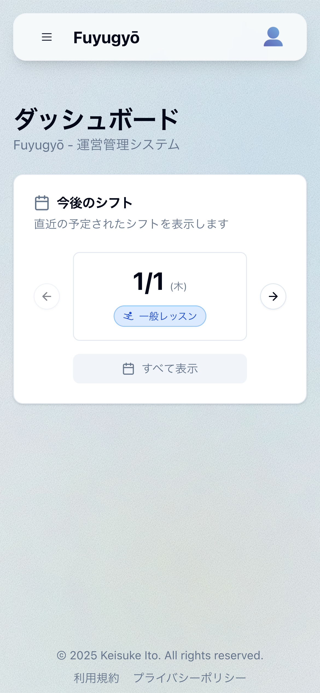
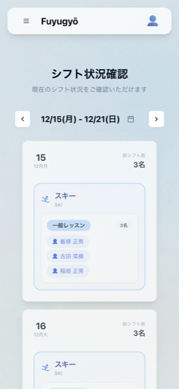
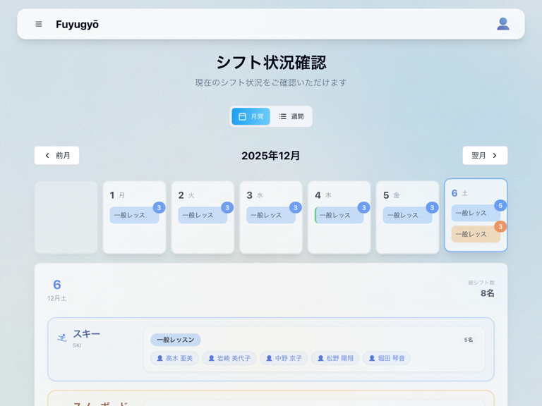
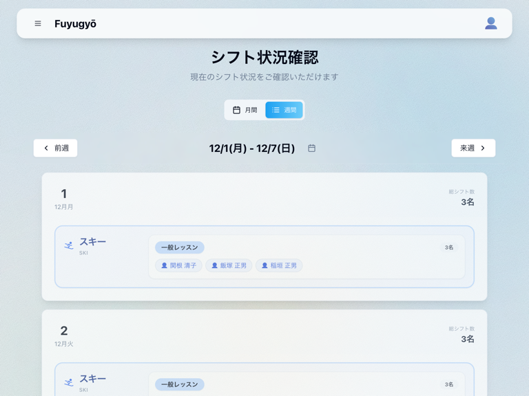

# メンバー向け利用マニュアル

このマニュアルでは、本システムのメンバー向け利用方法について説明します。

スマートフォンでは、画面下部のアイコンから移動できます。左から「ホーム」（家）、「シフト表」（カレンダー）、「シフト希望」（クリップボード＋チェック）、「その他」（三本線）です。MANAGER・ADMIN には「その他」の前に「シフト管理」（カレンダー＋歯車）も表示されます。「その他」をタップすると、アカウント操作と権限に応じた管理メニューが開きます。

インストラクター未連携の場合もタブの位置は変わりません。「シフト希望」には鍵のマークが付き、連携するまで利用できません。インストラクターの方は、管理者に連携を依頼してください。シフト表は未連携でも閲覧できます。PC では引き続きサイドバーから移動します。

スマートフォンのホーム・シフト表では、下へスクロールすると下部タブが隠れます。上へ少しスクロールすると再表示されます。シフト表の「↑ 上へ戻る」から先頭へ戻ることもできます。シフト希望・シフト管理などの編集画面では、タブは表示されたままです。

## 1. 招待〜ログイン

本システムを利用するには、まず管理者からの招待が必要です。

1.  **招待依頼**
    所属するスクールの管理者に、システムへの招待を依頼してください。

2.  **招待リンクの確認**
    管理者から LINE で招待リンクが共有されます。共有された招待リンクをタップしてください。招待リンクは発行から 24 時間で使えなくなります。期限が切れた場合は、管理者に再発行を依頼してください。

3.  **LINE でログイン**
    招待リンクにアクセスすると、ログイン画面が表示されます。
    「LINE でログイン」ボタンをタップしてください。

    

    通常、LINE アプリが起動し認証が完了しますが、場合によっては LINE のログイン画面が表示されることがあります。その際は、LINE に登録しているメールアドレスとパスワードを入力して認証を完了させてください。

    

    認証が完了すると、自動的にユーザー登録とログインが行われます。LINE の画面で公式アカウントの友だち追加を案内されることがあります。

### 管理者向け: 招待リンクを発行する

招待リンクの発行と停止ができるのは管理者（ADMIN）だけです。

1.  **招待リンクを開く**
    「ユーザー管理」の右上にある「招待リンク」をタップします。開くと同時にリンクが発行され、URL・有効期限（日本時間）・共有用の文面が表示されます。同じ管理者が発行から 1 時間以内にもう一度開いた場合は、同じリンクが表示されます。

2.  **LINE で送る**
    スマートフォンでは「LINE で送る」、PC では「リンクをコピー」が主な操作です。「LINE で送る」をタップすると LINE の送信先選択画面が開き、個別トークやグループへ送れます。

3.  **リンクを停止する**
    「発行済みの招待リンク」を開くと、発行者・有効期限・使用回数が確認でき、「停止」で使えなくできます。現在表示しているリンクを停止すると共有はできなくなります。再度共有するには「新しいリンクを発行」をタップしてください。

## 2. インストラクターの紐付け

ログイン後、ご自身のユーザーアカウントとインストラクター情報を紐付ける必要があります。これにより、自分のシフトが確認しやすくなります。シフト希望の登録にも紐付けが必要です。インストラクターの方は、管理者に連携を依頼してください。

1.  **管理者に連携を依頼する**
    ご自身での紐付け操作はありません。インストラクターの方は、管理者にインストラクター情報との連携を依頼してください。未連携の間は、スマートフォンでは「その他」、PC では右上のアカウントメニューに連携を依頼する旨の案内が表示されます。

2.  **連携後の表示**
    管理者が連携すると、あなたのアカウントとインストラクター情報が紐付けられます。連携先は同じ場所で確認できます。紐付けがなくてもシフトの確認は可能ですが、シフト希望の登録や自分のシフトのハイライト機能などは利用できません。

    

## 3. シフトの確認方法

シフト確認ページでは、紐付けが完了していなくてもシフトを確認できます。インストラクター情報の紐付けを行うことで、自分のシフトがハイライト表示されるようになります。

1.  **シフトページへ移動**
    スマートフォンでは画面下部の「シフト表」をタップし、PC ではサイドバーの「シフト表」を選択します。

    

2.  **表示モードの切り替え**
    シフトページは、デフォルトで週間表示になっています。
    PC など画面幅が大きい端末で表示すると、月間ビューを利用できるようになります。

    - **月間表示**: 画面上部にある「月間」タブをクリックすると、カレンダー形式の月間表示に切り替わります。

    
    - **週間表示**: 「週間」タブをクリックすると、週間表示に戻ります。

    

## 4. シフトの印刷方法

月間シフト表を印刷用のレイアウトで表示し、紙に印刷したり PDF として保存したりできます。

1.  **印刷する月と部門を選ぶ**
    シフト確認ページ上部の「印刷」ボタンをクリックすると、印刷条件のダイアログが開きます。

    - **対象月**: 初期値は、ボタンを押した時点で画面の一番上に見えている日付の月です。別の月を印刷したいときは、入力欄をクリックしてカレンダーから選び直してください。ダイアログを開いた後は、選んだ月が勝手に変わることはありません。
    - **部門**: 「両部門」「スキーのみ」「スノーボードのみ」から選びます。初期値は両部門です。

    シフト確認ページの絞り込み（部門・「自分だけ」）は印刷には引き継がれず、常に全担当者が印刷されます。

2.  **印刷用ページを開く**
    「印刷用ページを開く」ボタンをクリックすると、別のタブで印刷用ページが開きます。
    元のシフト確認ページはそのまま残るため、印刷後もスクロール位置を保ったまま閲覧を続けられます。

    月初から月末までの全日付が縦に並びます。担当者がいない日は、その場で手書きできる空欄になります。

3.  **印刷**
    印刷用ページを開いただけでは印刷画面は開きません。ページ右上の「印刷」ボタンをクリックすると、ブラウザの印刷画面が開きます。
    プリンターの選択や「PDF として保存」は、ブラウザの印刷ダイアログから設定できます。
    用紙は A4 縦・白黒での印刷を想定しています。余白は「デフォルト」、倍率は 100% のまま印刷してください。
    読みやすい文字の大きさと手書き用の空欄を保つため、1 か月は 2 ページ程度に分かれます（担当者や種別が多い月はさらに増えます）。1 枚に収めるために文字を小さくすることはありません。
    同じ日付の内容は、ページの前後に分かれません（1 日分の担当者が 1 ページに収まらないほど多い場合のみ分かれます）。2 ページ目以降にも「日付・部門」の見出しと対象年月が印刷されます。
    操作ボタンやナビゲーションは印刷されません。
